# 1. Introduction

Formula 1 results come from many interacting factors — car performance, driver skill, qualifying, reliability,
strategy and circuit. This project asks a narrow, testable question: **using only information available before a
Grand Prix starts, can we identify which drivers finish on the podium (P1–P3)?** It is a binary classification task
with an imbalanced positive class, built as an end-to-end, reproducible pipeline: data collection from a public API,
leakage-safe feature engineering, a chronological train/validation/test split, tuning and comparison of four
classical algorithms (Decision Tree, K-Nearest Neighbours, Support Vector Machine, Random Forest), overfitting and
feature-ablation experiments, and an interactive Streamlit application usable on desktop and Android browsers.
The system is educational; it is not a professional race-forecasting or betting tool.

Research questions: (Q1) which pre-race features matter most; (Q2) how the four algorithms compare; (Q3) how feature
selection and model complexity drive over/underfitting; (Q4) whether more features improve generalisation;
(Q5) which model best balances accuracy, interpretability, cost and speed; (Q6) whether the findings can be
communicated through an interactive application.

# 2. Literature Review

Sport-prediction surveys frame most outcome prediction as classification on historical-form features and evaluate
with time-ordered splits [1, 2]. F1-specific statistical work consistently finds the constructor (car) explains
more of the variation in results than the driver — Bell et al. with multilevel models over 1950–2014 [3] and
van Kesteren & Bergkamp with a Bayesian rank-ordered logit on 2014–2021 Ergast data (constructors ≈ 88% of
variance) [4]; a 2025 preprint using ridge regression with walk-forward evaluation on 2014–2024 reaches a similar
conclusion [11]. Recent applied ML studies use SVM, Random Forest and ensembles [9, 10], but at least one mixes
features only known after the race (pit-stop statistics) with a random split [9] — exactly the leakage pattern
formalised by Kaufman et al. [5] and catalogued by Kapoor & Narayanan [6]. For time-dependent data, a hold-out of
the latest period complemented by forward-chaining validation is recommended [7]. For imbalanced targets,
precision-recall analysis is more informative than ROC [8].

| Ref. | Approach | Take-away used here |
|--------------------------------|-----------------------------------------|------------------------------------------------------------|
| [3] Bell et al. 2016 | Multilevel model, 1950–2014 | Team form as separate features; standardised points |
| [4] van Kesteren & Bergkamp 2023 | Bayesian rank-ordered logit, 2014–21 | Same data source; team-lineage fix for rebrands |
| [9] Krzysztoń & Smołka 2026 | SVM/RF/GB ensemble, 2023–24, random split | Contrast: strictly pre-race features, season split |
| [11] Rane 2025 (preprint) | Ridge + time decay, walk-forward | Rolling-origin check |
| [5, 6] Leakage | Formalism; 294-paper survey | Shift-before-aggregate; pipeline-fitted preprocessing; tests |
| [7] Bergmeir & Benítez 2012 | CV vs last-block evaluation | Temporal hold-out + rolling origin |
| [8] Saito & Rehmsmeier 2015 | PR vs ROC under imbalance | Model selection by average precision |

*Table 1. Literature positioning (full review of 11 verified works: `reports/literature_review.md`).* "State-of-the-art
comparison" in this report means positioning against this literature plus a like-for-like benchmark of four syllabus
algorithms; it does not claim these algorithms are the newest research methods.

# 3. Methodology

The workflow is `collect → clean → engineer features → split → tune on validation → select → refit → test once`,
implemented as separate modules in `src/` and run end-to-end with `python -m src.run_all`. Selection decisions use
the validation seasons only; the test seasons are evaluated a single time after all choices are frozen. All
learned preprocessing (median imputation, standard scaling, one-hot encoding) lives inside a scikit-learn
`Pipeline`/`ColumnTransformer`, so it is fitted on training rows only. Seeds are fixed (`random_state=42`).

# 4. Dataset and Data Cleaning

**Source.** Jolpica-F1 API (Ergast-compatible) results, qualifying and schedule endpoints, retrieved 2026-10-26
and cached as raw JSON with a manifest (URL, timestamp, row counts). Seasons 2000–2013 (5,445 entries)
are downloaded *only* to give realistic driver/team histories; 2014–2024 is the study period: 228 Grands
Prix and 4,626 entries. All scheduled races have results; qualifying coverage is 99.7%.

**Cleaning.** Type conversion with failure counts, removal of exact duplicates and invalid identifiers, a verified
unique `(season, round, driver)` key, a chronological race index, pit-lane starts (grid 0) recoded with an explicit
flag, and qualifying merged on the key. **Inclusion policy:** only entries with a numeric classified position receive
a target; non-classified entries are excluded rather than labelled "non-podium" (Table 2) but still contribute to
historical features. The supervised dataset has 3,910 rows with a podium rate of 17.5%; every race
retains exactly three podium finishers.

| Reason | Rows |
|-------------------------|--------|
| retired (not classified) | 676 |
| withdrawn / did not start | 31 |
| disqualified | 9 |

*Table 2. Study-period entries excluded from the supervised dataset (716 in total).*

**EDA highlights** (figures below). Pole-sitters finish on the podium 88.0% of the time, grid 2–3 67.8%, grid 4–6
24.5% and grid 11+ only 1.4%; 68.7% of all podiums come from the first three grid slots. Podium
rate rises with experience, but this is largely survivorship (successful drivers keep their seats), not causation.

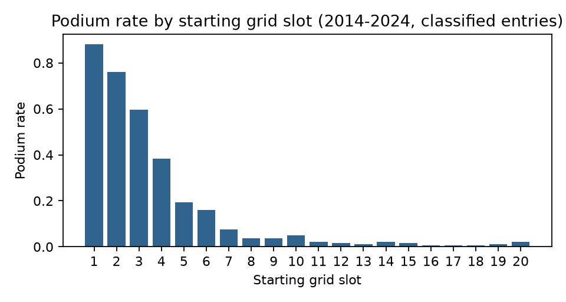{width=52%} 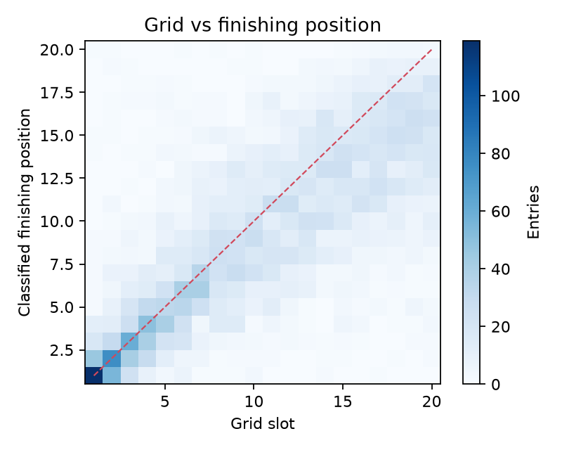{width=40%}

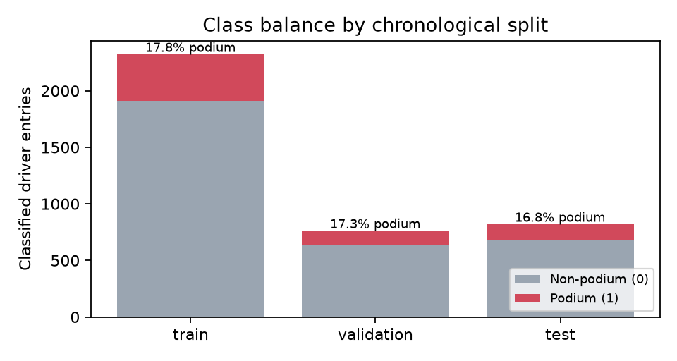{width=46%} 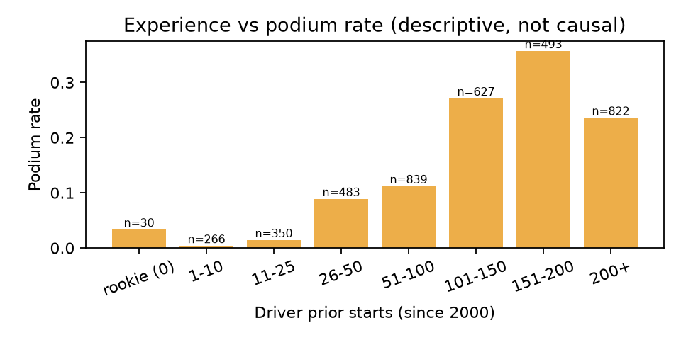{width=46%}

# 5. Feature Engineering and Leakage Prevention

Every historical feature for race *r* is computed from races with index < *r*: each driver's and team's sequence is
sorted chronologically and shifted by one race before any rolling or expanding aggregate. Four groups are defined
for ablation: **A — basic** (grid, pit-lane flag, season, round, circuit, driver and constructor IDs);
**B — recent form** (driver/team mean race-order position over the previous 3/5 races, podiums, standardised
points per race, DNF rate, mean grid, history flags); **C — experience** (career starts, team prior races, starts
with current team, races since last start, rookie/returning/team-change flags); **D — career context** (career mean
position and podium rate, driver/team season points before the race and their in-race ranks, grid − qualifying).

Design decisions: points are recomputed on a single 25-18-…-1 scale for all seasons; team form follows a *lineage*
(e.g. Toro Rosso → AlphaTauri → RB) so rebrands do not erase history; after a **transfer** the driver keeps personal
form while team experience resets and team form switches to the new team (53 team-change entries);
**returning** drivers keep history plus a gap feature (18 entries); **rookies** (38 entries)
keep missing form as `NaN` — never 0, which would mimic a winner — and are imputed with the training median alongside
explicit history flags. Post-race fields (position, status, points, laps, fastest lap, final standings) are never
features. Automated tests scramble the target race and all future races and assert that the target race's features
are byte-identical, while changing a past race does change them.

| Grp | Feature | Definition (computed from earlier races only) |
|--------|------------------------|----------------------------------------------------------------------|
| A | `grid_clean` | Starting grid slot; pit-lane starts (grid 0) set to the number of entrants |
| A | `grid_pitlane` | 1 if the driver started from the pit lane |
| A | `season` | Championship year |
| A | `round` | Round number within the season (race order) |
| A | `circuit_id` | Circuit identifier (one-hot) |
| A | `driver_id` | Driver identifier (one-hot; unseen drivers -> all zeros) |
| A | `constructor_id` | Official constructor identifier (one-hot; unseen -> all zeros) |
| B | `drv_avg_pos_3` | Driver mean race order position, previous 3 starts |
| B | `drv_avg_pos_5` | Driver mean race order position, previous 5 starts |
| B | `drv_podiums_5` | Driver podiums in previous 5 starts |
| B | `drv_ppr_5` | Driver standardised points per race, previous 5 starts |
| B | `drv_dnf_rate_5` | Share of the driver's previous 5 starts that were not classified |
| B | `drv_avg_grid_5` | Driver mean grid slot, previous 5 starts (qualifying pace proxy) |
| B | `con_avg_pos_3` | Team mean race order position (all cars), previous 3 races |
| B | `con_avg_pos_5` | Team mean race order position (all cars), previous 5 races |
| B | `con_podiums_5` | Team podiums, previous 5 races |
| B | `con_ppr_5` | Team standardised points per race, previous 5 races |
| B | `drv_has_history` | 1 if the driver has at least one previous start (since history start) |
| B | `con_has_history` | 1 if the team lineage has at least one previous race |
| C | `drv_career_starts` | Driver starts before this race (counted from history_start_season) |
| C | `con_prior_races` | Team-lineage races before this race (counted from history_start_season) |
| C | `drv_races_with_con` | Driver's previous starts with the current team lineage |
| C | `drv_gap_races` | Championship races held since the driver's previous start |
| C | `is_rookie` | 1 if no previous start |
| C | `is_returning` | 1 if the gap since the previous start >= returning_gap_races |
| C | `con_changed` | 1 if the team lineage differs from the driver's previous start |
| D | `drv_career_avg_pos` | Driver mean race order position over all previous starts |
| D | `drv_career_podium_rate` | Driver podium share over all previous starts |
| D | `drv_season_pts_before` | Driver standardised points earned earlier in this season |
| D | `drv_season_rank_before` | Driver rank among this race's entrants by season points before the race |
| D | `con_season_pts_before` | Team standardised points earned earlier in this season |
| D | `con_season_rank_before` | Team rank among this race's teams by season points before the race |
| D | `grid_minus_quali` | Grid slot minus qualifying position (grid penalties/promotions); 0 if no qualifying record |
| D | `quali_missing` | 1 if no qualifying record exists for this entry |

*Table 3. Feature definitions by group (A basic, B recent form, C experience, D career context).*

# 6. Experimental Setup

| Split | Seasons | Races | Rows | Podiums | Podium rate |
|----------|---------|--------|--------|--------|-----------|
| Train | 2014–2020 | 138 | 2,324 | 414 | 17.8% |
| Validation | 2021–2022 | 44 | 764 | 132 | 17.3% |
| Test | 2023–2024 | 46 | 822 | 138 | 16.8% |

*Table 4. Chronological split, fixed before modelling; no race spans two splits.* Validation deliberately spans the
2022 regulation change.

**Algorithms and search.** Decision Tree (entropy/gini; depth, leaf and split sizes; 240-point grid); KNN (K,
uniform/distance weighting, Euclidean/Manhattan; 28 points); SVM (linear and RBF kernels as configurations of one
algorithm; C and gamma; 15 points); Random Forest (trees, depth, leaf size, max features; 30 random draws). Tree
models and the SVM use balanced class weights. Each model is tuned separately on each of five feature-group
combinations using a predefined train→validation split; **selection metric: validation average precision (AP)**,
which is threshold-free and focuses on the minority class [8]. The best configuration per model is refitted on
2014–2022 and tested once on 2023–2024. Supplementary metrics: accuracy, precision, recall, F1 (default threshold),
ROC-AUC, Brier score, confusion matrices, and a race-level **top-3 hit rate** (share of each race's three
highest-scored drivers who actually finished on the podium). A non-ML **grid-slot reference** (rank drivers by
starting slot) is reported for context. Environment: Python 3.13.17, scikit-learn 1.9.1, 2 CPU cores,
7.8 GB RAM.

| Model | Search | Space |
|-------------|--------|----------------------------------------------------------------------|
| Decision Tree | grid | crit ∈ {entropy, gini}; depth ∈ {2, 3, 4, 5, 6, 8, 10, None}; leaf ∈ {1, 5, 10, 20, 50}; split ∈ {2, 20, 50} |
| KNN | grid | K ∈ {5, 9, 15, 25, 41, 61, 91}; w ∈ {uniform, distance}; dist ∈ {euclidean, manhattan} |
| SVM | grid | kernel ∈ {linear}; C ∈ {0.01, 0.1, 1} **or** kernel ∈ {rbf}; C ∈ {0.1, 1, 10}; γ ∈ {scale, 0.003, 0.01, 0.03} |
| Random Forest | random | trees ∈ {100, 200, 400}; depth ∈ {4, 6, 8, 10, 14, None}; leaf ∈ {1, 3, 5, 10, 20}; feat ∈ {sqrt, 0.3, 0.5} |

*Table 5. Hyperparameter search spaces (grid = exhaustive; random = 30 draws, seed 42).*

# 7. Results and Discussion

| Model | Feat. | Acc. | Prec. | Rec. | F1 | ROC-AUC | AP | Top-3 |
|---------------------|--------|--------|--------|--------|--------|--------|--------|--------|
| Decision Tree | A+B | 0.873 | 0.591 | 0.864 | 0.702 | 0.939 | 0.754 | 0.712 |
| KNN | A+B | 0.891 | 0.693 | 0.667 | 0.680 | 0.919 | 0.735 | 0.667 |
| SVM | A | 0.868 | 0.576 | 0.894 | 0.700 | 0.940 | 0.799 | 0.727 |
| Random Forest | A+B+C | 0.890 | 0.645 | 0.811 | 0.718 | 0.944 | 0.805 | 0.712 |
| *Grid-slot reference* | grid | 0.902 | 0.739 | 0.667 | 0.701 | 0.919 | 0.715 | 0.727 |

*Table 6. Validation (2021–22) metrics of each model's selected configuration (trained on 2014–20).*

| Model | Feat. | Acc. | Prec. | Rec. | F1 | ROC-AUC | AP | Top-3 |
|---------------------|--------|--------|--------|--------|--------|--------|--------|--------|
| Decision Tree | A+B | 0.833 | 0.502 | 0.862 | 0.635 | 0.916 | 0.647 | 0.645 |
| KNN | A+B | 0.850 | 0.550 | 0.594 | 0.571 | 0.882 | 0.582 | 0.565 |
| SVM | A | 0.814 | 0.467 | 0.775 | 0.583 | 0.899 | 0.672 | 0.551 |
| Random Forest | A+B+C | 0.854 | 0.542 | 0.833 | 0.657 | 0.929 | 0.690 | 0.681 |
| *Grid-slot reference* | grid | 0.892 | 0.687 | 0.652 | 0.669 | 0.910 | 0.693 | 0.681 |

*Table 7. Test (2023–24) metrics, refitted on 2014–22. Top-3 = race-level top-3 hit rate.*

On validation, **Random Forest** (AP 0.805) and
**SVM** (AP 0.799) lead, clearly above the grid-slot reference
(AP 0.715). On the held-out test seasons all models fall: the best test AP is 0.690
(Random Forest), essentially equal to the grid reference (AP 0.693, top-3 hit rate 0.681).
Accuracy (0.81–0.85) is uninformative here because predicting "no podium" for everyone already scores about 83%.
The tree models and SVM trade precision for recall (balanced class weights move the default threshold), while
unweighted KNN is more conservative.

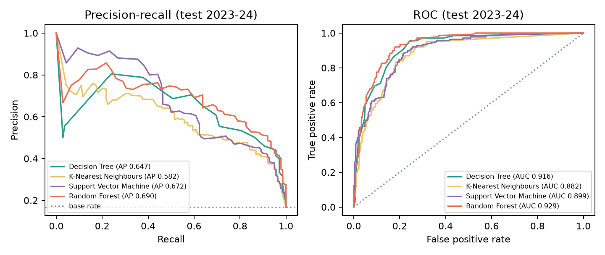{width=88%}

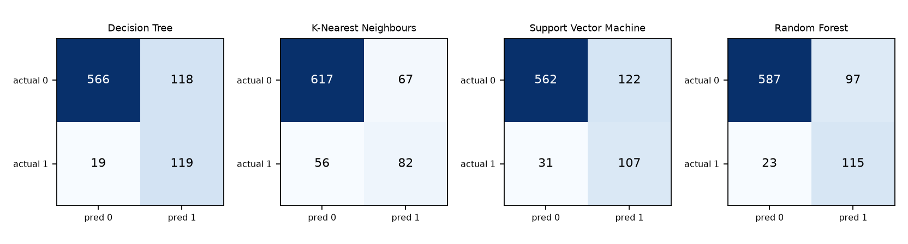{width=92%}

**Q1 — useful features.** Permutation importance on validation for the Random Forest ranks `grid_clean` (0.244), `con_ppr_5` (0.062), `drv_ppr_5` (0.051), `con_podiums_5` (0.033), `con_prior_races` (0.030). Grid slot and
recent **team** points per race dominate every model, consistent with constructor-dominance findings [3, 4]; the
Decision Tree's root split is team points per race followed by grid slot (`reports/figures/model_decision_tree.png`).
Identity features also appear (e.g. a `driver_id` split for one dominant driver), which helps inside an era but
transfers poorly to the next one. Permutation importance measures the drop in validation AP when one raw column is
shuffled; correlated features share credit, so low values do not mean a feature is useless.

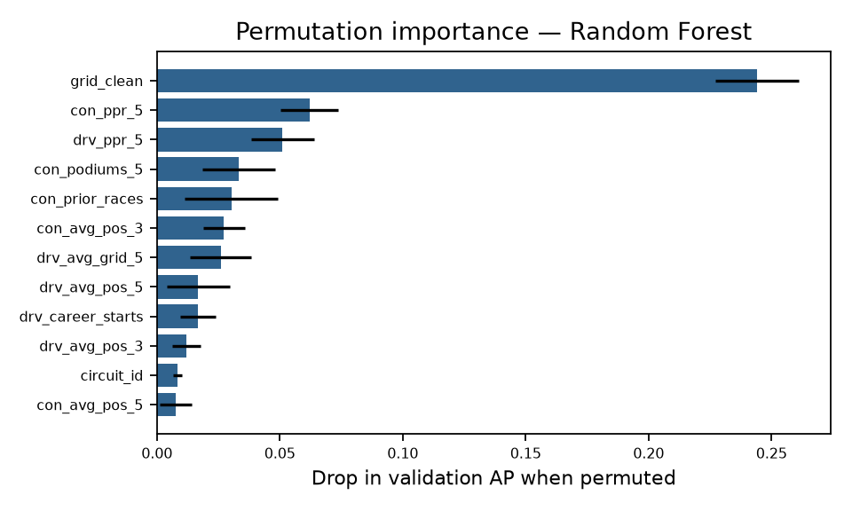{width=62%}

# 8. Comparative Model Performance

| Scorer | Test AP 95% CI | AP − grid (95% CI) | P(boot > grid) |
|-------------------|--------------|------------------|--------------|
| Grid-slot reference | 0.621–0.769 | — | — |
| Decision Tree | 0.579–0.727 | -0.085 to -0.007 | 1.1% |
| KNN | 0.510–0.665 | -0.191 to -0.030 | 0.4% |
| SVM | 0.600–0.744 | -0.077 to +0.036 | 24.9% |
| Random Forest | 0.621–0.766 | -0.040 to +0.036 | 45.9% |

*Table 8. Race-level bootstrap (2000 resamples of 46 test races).* The confidence
intervals of Random Forest, SVM and the grid reference overlap almost completely and their AP differences against
the grid include zero; the Decision Tree and KNN are measurably worse than the grid reference on 2023–24. With 46
test races, **the test data cannot separate the best models from a grid-only ranking.**

| Model | Cand. | Search time, 5 sets (s) | Final fit (s) | Batch latency (µs/row) | Single-row (ms) |
|-------------|--------|-----------------------|-------------|----------------------|---------------|
| Decision Tree | 240 | 61 | 0.028 | 8.5 | 5.0 |
| KNN | 28 | 73 | 0.020 | 31.1 | 6.6 |
| SVM | 15 | 27 | 0.365 | 133.1 | 7.4 |
| Random Forest | 30 | 112 | 0.867 | 80.1 | 61.8 |

*Table 9. Tuning cost and timing (this machine; timings vary by hardware).*

**Q5 — balance.** The pre-registered criterion (best validation AP) selects **Random Forest** (validation
0.805, test 0.690). It is the strongest model on validation and ties for best on test, but it is the
most expensive to train and, with parallel prediction, the slowest for a single row. The **SVM** with only basic
features is nearly as accurate, has the smallest train–validation gap and a tiny model, but outputs margins rather
than probabilities and has the highest batch latency per row. The **Decision Tree** is the most interpretable and
fastest, at a measurable accuracy cost. **KNN** is weakest and memory-bound (it stores the training set).

# 9. Overfitting, Underfitting and Feature Ablation

| Model | Selected hyperparameters | Train AP | Val AP | Gap | Test AP |
|-------------|---------------------------------------|--------|--------|--------|--------|
| Decision Tree | crit=entropy, depth=5, leaf=50, split=2 | 0.809 | 0.754 | 0.054 | 0.647 |
| KNN | dist=euclidean, K=9, w=distance | 1.000 | 0.735 | 0.265 | 0.582 |
| SVM | C=1, γ=0.003, kernel=rbf | 0.791 | 0.799 | -0.009 | 0.672 |
| Random Forest | trees=200, leaf=3, feat=0.3, depth=14 | 0.988 | 0.805 | 0.183 | 0.690 |

*Table 10. Generalisation: training vs validation AP (both from the 2014–20 fit) and test AP.*

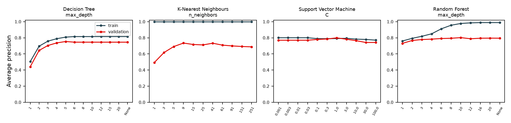{width=100%}

**Complexity (Q3).** The Decision Tree underfits at depth 1–2 (validation AP 0.442
at depth 1) and plateaus from depth ≈5; the large selected leaf size (50) prevents memorisation, giving a small gap
(0.054). KNN's training AP is 1.0 for every K because distance weighting lets
each training row vote for itself — a textbook overfitting signature; validation AP peaks around K = 9–41 and
declines as K grows (smoothing towards the base rate). The SVM curve is flat: training and validation AP stay within
0.04 of each other at every C (high bias, low variance), so the margin model is limited by the information in the
features rather than by capacity. The Random Forest's training AP climbs to ≈0.99 with depth while validation AP
stays near 0.80 — a large gap (0.183) that averaging keeps from hurting
validation, but which reappears as the drop to 0.690 on test.
Learning curves (figure below) show validation AP improving with more seasons for the
Decision Tree (0.51 → 0.75), but little gain beyond three seasons for the other models, suggesting the limit is
feature information, not data volume.

| Feature groups | Decision Tree | KNN | SVM | Random Forest |
|--------------|-------------|---------|---------|-------------|
| A | 0.727 | 0.717 | **0.799** | 0.785 |
| A+B | **0.754** | **0.735** | 0.767 | 0.792 |
| A+C | 0.708 | 0.712 | 0.794 | 0.792 |
| A+B+C | 0.752 | 0.732 | 0.774 | **0.805** |
| A+B+C+D | 0.743 | 0.727 | 0.772 | 0.805 |

*Table 11. Feature-group ablation: best validation AP after tuning each model on each feature set (bold = selected).*

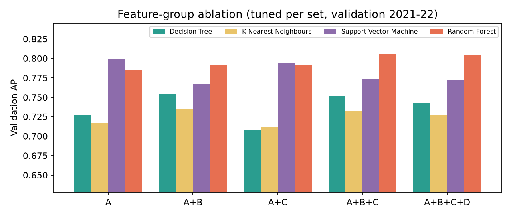{width=85%}

**Feature ablation (Q4).** More features did **not** reliably help. Recent form (B) helps the Decision Tree and KNN
(A → A+B: 0.727 → 0.754, 0.717 →
0.735); experience (C) alone hurts both; the Random Forest gains steadily up to A+B+C
(0.785 → 0.805); the SVM is best with the basic set
(0.799) and *loses* AP with any additions (full set 0.772). Group D never improves on the
best smaller set. Likely causes: many form/standing features are strongly correlated with grid slot and with each
other (Spearman matrix, Data Explorer), adding noise dimensions to distance- and margin-based models; and the
2022 regulation reset weakened the link between pre-2022 form and validation-season results.

**Robustness.** Rolling-origin evaluation (train on all earlier seasons, test on each season 2017–2022) gives SVM AP
between 0.734 and 0.807 and Random Forest between 0.683
and 0.813: season-to-season variation is as large as the differences between models.
Retraining with every starter (retirements labelled 0) lowers validation AP for all models (Table 12), because
unpredictable retirements remove podium finishers that a pre-race model ranks highly.

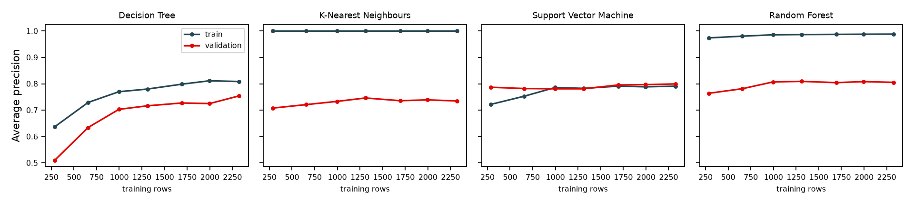{width=100%}

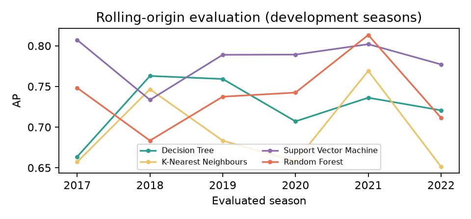{width=62%}

| Model | Val AP (classified only) | Val AP (all starters) | Top-3 hit (all starters) |
|-------------|------------------------|---------------------|------------------------|
| Decision Tree | 0.754 | 0.658 | 0.682 |
| KNN | 0.735 | 0.623 | 0.598 |
| SVM | 0.799 | 0.719 | 0.697 |
| Random Forest | 0.805 | 0.715 | 0.659 |

*Table 12. Target-policy sensitivity (validation 2021–22).*

# 10. UI Development and Deployment

The Streamlit application (`streamlit run app.py`) has six pages: **Overview** (task, data coverage, results
summary, limitations); **Data Explorer** (filters by season/constructor/driver/circuit; data-quality, exclusions,
missing-history, grid, trend, distribution, decile and correlation charts computed live); **Race Explorer**
(historical grid, qualifying and classification, kept separate from predictions); **Model Telemetry** (per-model
metrics on all splits, confusion matrices, ROC/PR/reliability curves, complexity and learning curves, permutation
importance, ablation, timing and hyperparameters); **Model Comparison** (common table, grid reference, bootstrap
intervals, ablation, timing, sensitivity, preferred model with its explicit criterion); and **Podium Predictor**
(choose season, Grand Prix, model and driver; entrants come from that race's real result sheet, so historical
line-ups and transfers are always correct; drivers are ranked by score, in-sample seasons are flagged, and the
actual result is revealed only on request). The app only reads saved artefacts, so pages never retrain models;
missing data, missing artefacts and unknown races produce explanatory messages, verified with Streamlit's AppTest
harness. Responsive CSS stacks columns and enlarges touch targets below 640 px (screenshots below). For a live demo, the app
is served on the local network (`--server.address 0.0.0.0`) and opened in Chrome on an Android phone; Streamlit
Community Cloud steps are in `docs/deployment.md`. No public deployment URL is claimed.

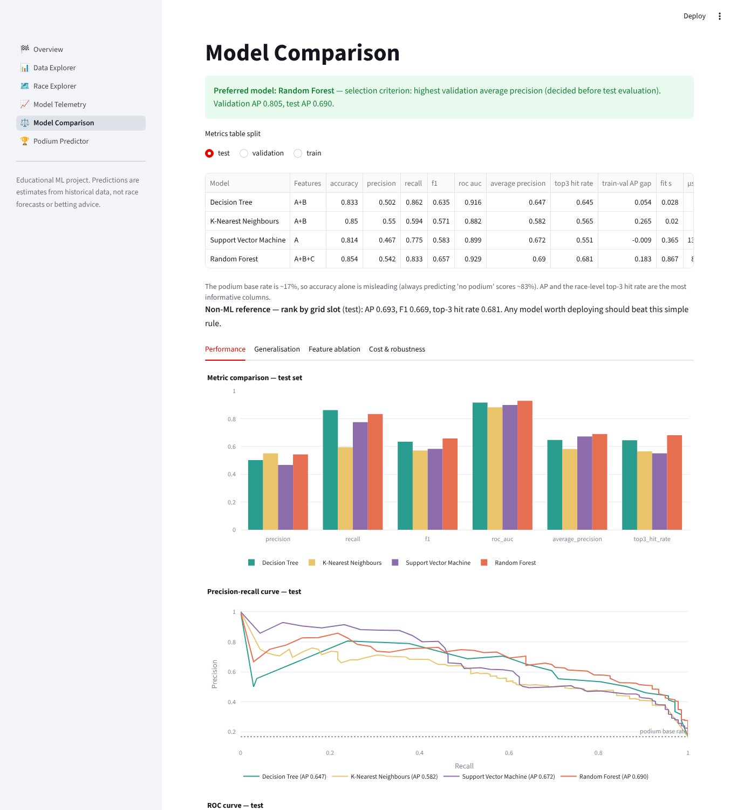{width=62%} 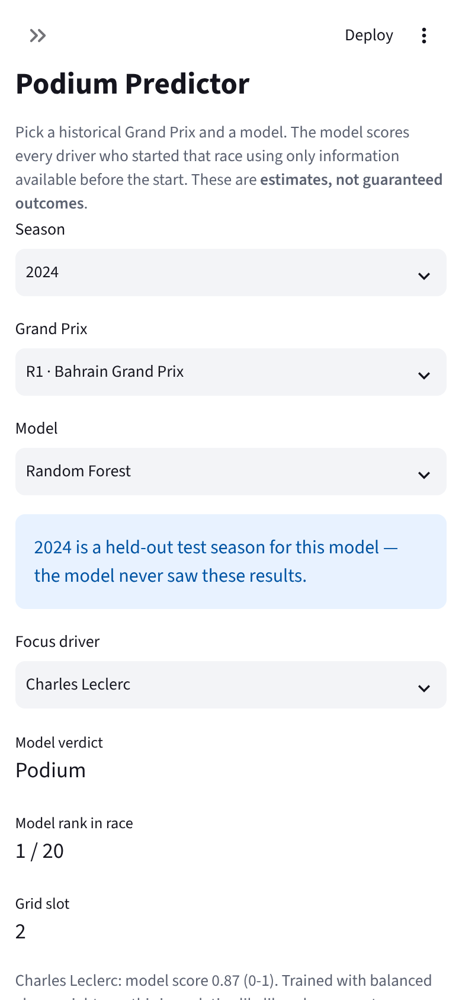{width=22%}

# 11. Limitations and Future Scope

Scores are conditional on finishing (retirements are not predictable pre-race) and are not calibrated
probabilities (balanced weights inflate them; Brier scores and reliability curves are in the app). Features exclude
weather, tyres, upgrades, practice pace and telemetry; FastF1 practice/qualifying pace is the most promising
extension. Driver/constructor IDs help within an era but encode yesterday's hierarchy. Career counts start in
2000. Two test seasons (46 races) give wide confidence intervals; 2023 was dominated by one team. Future work:
calibration (Platt/isotonic on validation), ranking objectives (learning-to-rank or Plackett-Luce), regulation-era
indicators, gradient-boosting models, and sprint-race data.

# 12. Conclusion

A leakage-safe, reproducible pipeline was built on 228 Grands Prix (2014–2024). Four algorithm families were
tuned on five feature sets with validation-only selection. Grid slot and recent team form carry most of the signal.
The Random Forest (selected) and SVM beat a grid-only ranking on validation, but on 2023–24 no model is
distinguishable from that simple reference, while the Decision Tree and KNN are worse. More features helped the
Random Forest but hurt the SVM, and diagnostic curves expose overfitting (KNN, deep Random Forest) and high bias (SVM)
directly. The honest conclusion is that pre-race public data supports *ranking* likely podium finishers about as
well as the starting grid does; the project's value is a transparent, tested methodology and an application that
communicates both the findings and their limits.

# 13. References

[1] Rory P. Bunker; Fadi Thabtah (2019). A machine learning framework for sport result prediction. *Applied Computing and Informatics 15(1):27-33*. https://doi.org/10.1016/j.aci.2017.09.005

[2] Tomislav Horvat; Josip Job (2020). The use of machine learning in sport outcome prediction: A review. *WIREs Data Mining and Knowledge Discovery 10(5):e1380*. https://doi.org/10.1002/widm.1380

[3] Andrew Bell; James Smith; Clive E. Sabel; Kelvyn Jones (2016). Formula for success: Multilevel modelling of Formula One Driver and Constructor performance, 1950-2014. *Journal of Quantitative Analysis in Sports 12(2):99-112*. https://doi.org/10.1515/jqas-2015-0050

[4] Erik-Jan van Kesteren; Tom Bergkamp (2023). Bayesian analysis of Formula One race results: disentangling driver skill and constructor advantage. *Journal of Quantitative Analysis in Sports 19(4):273-293*. https://doi.org/10.1515/jqas-2022-0021

[5] Shachar Kaufman; Saharon Rosset; Claudia Perlich; Ori Stitelman (2012). Leakage in data mining. *ACM Transactions on Knowledge Discovery from Data 6(4):1-21*. https://doi.org/10.1145/2382577.2382579

[6] Sayash Kapoor; Arvind Narayanan (2023). Leakage and the reproducibility crisis in machine-learning-based science. *Patterns 4(9):100804*. https://doi.org/10.1016/j.patter.2023.100804

[7] Christoph Bergmeir; José M. Benítez (2012). On the use of cross-validation for time series predictor evaluation. *Information Sciences 191:192-213*. https://doi.org/10.1016/j.ins.2011.12.028

[8] Takaya Saito; Marc Rehmsmeier (2015). The Precision-Recall Plot Is More Informative than the ROC Plot When Evaluating Binary Classifiers on Imbalanced Datasets. *PLOS ONE 10(3):e0118432*. https://doi.org/10.1371/journal.pone.0118432

[9] Sylwia Krzysztoń; Jakub Smołka (2026). Application of machine learning for predicting Formula 1 race results. *Journal of Computer Sciences Institute 38:81-86*. https://doi.org/10.35784/jcsi.8462

[10] Elias El Haber; Elie Sawaya; Maroun Attieh; Aldo Tannous; Weam Ghazaly; Michel Owayjan (2025). Formula 1 Race Winner Prediction Using Random Forest and SHAP Analysis. *2025 International Conference on Control, Automation, and Instrumentation (IC2AI), IEEE, pp.1270-1274*. https://doi.org/10.1109/IC2AI62984.2025.10932140

[11] Saurabh Rane (2025). Predicting Formula 1 Race Outcomes: Decomposing the Roles of Drivers and Constructors through Linear Modeling. *arXiv preprint arXiv:2508.00200 [stat.AP] (not peer reviewed)*. https://arxiv.org/abs/2508.00200

Data: Jolpica-F1 API, https://github.com/jolpica/jolpica-f1 (accessed as recorded in `data/raw/manifest.json`).
Software: scikit-learn, pandas, NumPy, Streamlit, Plotly, Matplotlib.
